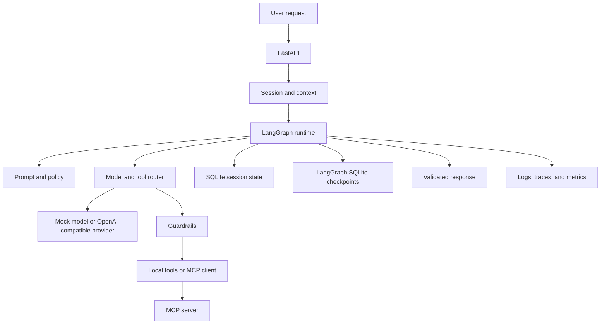

# agent-harness-starter

A modular, observable, and extensible Python Agent Harness built with LangGraph, MCP, FastAPI, and OpenTelemetry.

An Agent Harness is the deterministic frame around a model: session state, a workflow, tool permissions, retries, and traces. A chatbot can answer a question. This project shows a small harness that decides whether a tool may run, records the result, and keeps one session from reading another.

The default path uses a **mock model**. It is a deterministic pattern matcher, not an LLM, and it does not need an API key. An OpenAI-compatible provider is included and stays unused until you set it.

## Why an Agent Harness matters

A raw model call has no durable session, no allowlist, and no bound on how many times it may call a tool. The harness adds those controls without hiding them behind another framework. LangGraph is the only workflow engine. Everything else is a normal Python module the graph calls.

## Architecture



More detail is in [docs/architecture.md](docs/architecture.md) and [docs/design-decisions.md](docs/design-decisions.md).

## Eight core components

| # | Component | What it does here |
| --- | --- | --- |
| 1 | Session and context | Creates a UUID session, stores history, trims context, and closes or deletes that session only |
| 2 | Task orchestration | One LangGraph workflow with tool calls, failures, approval interrupts, and `max_steps` |
| 3 | Prompt and policy | Versioned templates and an execution policy. User text selects a template name and is not interpolated |
| 4 | Model and tool router | `ModelProvider` protocol, mock model, OpenAI-compatible client, tool registry, allowlist, argument validation |
| 5 | Memory and state | SQLite for sessions, messages, tasks, and explicit memories. LangGraph SQLite checkpoints for the workflow |
| 6 | Safety and guardrails | Input limits, allowlist, timeouts, output checks, log redaction, and approval for `delete_memory` |
| 7 | Agent runtime | Runs or resumes the graph, retries idempotent transient failures, and records task status |
| 8 | Observability | JSON logs, OpenTelemetry spans, task duration, and tool-call counters. Correlation ids are propagated |

## Features

- Calculator, UTC time, and text-statistics tools.
- Multi-step calculation and a session-scoped remembered fact.
- MCP discovery that registers only approved tool names.
- FastAPI endpoints and generated OpenAPI docs.
- Local traces without a hosted collector.
- Pytest coverage for isolation, limits, MCP success and failure, and the examples.

## Technology stack

- Python 3.11+
- LangGraph 1.2.20 and langgraph-checkpoint-sqlite 3.1.3
- MCP Python SDK 2.3.0 (`MCPServer` and `Client`)
- FastAPI 0.162.2, Pydantic 2.14.3, Uvicorn 0.54.0
- OpenTelemetry API/SDK 1.45.2
- SQLite in the Python standard library
- Pytest 9.2.0 and Ruff 0.17.4
- Docker and Docker Compose

LangChain Core is installed because LangGraph depends on it. This repository does not call LangChain directly. Versions above are the ones installed and tested.

## Installation

Tested locally with Python 3.13. The Docker image uses Python 3.11.

```bash
python3.13 -m venv .venv
source .venv/bin/activate
python -m pip install -e ".[dev]"
```

## Quick start

```bash
python examples/calculator_agent.py
```

Expected lines include:

```text
status: completed
tools: calculator
response: 125 multiplied by 48 is 6000.
```

The process also prints JSON logs and OpenTelemetry spans. Those lines do not contain the user sentence.

## Configuration

Copy `.env.example` and export the variables you need. Never commit a real `.env`.

| Variable | Default | Purpose |
| --- | --- | --- |
| `AGENT_HARNESS_MODEL_PROVIDER` | `mock` | `mock` or `openai` |
| `AGENT_HARNESS_OPENAI_API_KEY` | empty | Required only for `openai`. Not read from source code |
| `AGENT_HARNESS_OPENAI_BASE_URL` | `https://api.openai.com/v1` | OpenAI-compatible base URL |
| `AGENT_HARNESS_OPENAI_MODEL` | `gpt-4o-mini` | Model name |
| `AGENT_HARNESS_DATABASE_PATH` | `./data/harness.db` | SQLite file. Checkpoints use the sibling `.checkpoints` file |
| `AGENT_HARNESS_MAX_STEPS` | `8` | Graph step limit |
| `AGENT_HARNESS_TOOL_TIMEOUT_SECONDS` | `5` | Per tool attempt |
| `AGENT_HARNESS_MAX_RETRIES` | `2` | Extra attempts for idempotent transient failures |
| `AGENT_HARNESS_OTEL_EXPORTER` | `console` | `console` or `none` |
| `AGENT_HARNESS_ENABLE_MCP` | `true` | Discover the in-process MCP server |
| `AGENT_HARNESS_ALLOWED_TOOLS` | calculator, time, text stats, store, recall | Comma-separated allowlist |
| `AGENT_HARNESS_APPROVAL_TOOLS` | `delete_memory` | Tools that pause for approval when allowlisted |

`delete_memory` is not on the default allowlist, so the approval set does not make it callable by itself.

## Running the examples

All three examples force the mock provider so they stay reproducible.

```bash
python examples/calculator_agent.py
python examples/multi_step_agent.py
python examples/stateful_agent.py
```

Example B asks: "Calculate the total cost of 12 products at 49.90 each, then apply a 15% discount." The response line is:

```text
response: The discounted total is 508.98.
```

The tool list is `calculator,calculator`.

Example C stores "the unit price is 49.90" in one session and asks for it again. A second session answers that it does not have that price. The response lines include:

```text
answer_response: The remembered unit price is 49.90.
other_session_response: I do not have a remembered unit price in this session.
```

## REST API examples

Start the server:

```bash
uvicorn agent_harness.api.app:app --host 127.0.0.1 --port 8000
```

Interactive docs: `http://127.0.0.1:8000/docs`.

```bash
curl -s http://127.0.0.1:8000/health
```

```bash
curl -s -X POST http://127.0.0.1:8000/sessions
```

Use the returned `session_id`:

```bash
curl -s -X POST http://127.0.0.1:8000/agents/run \
  -H 'content-type: application/json' \
  -H 'X-Correlation-ID: demo-123' \
  -d '{"session_id":"SESSION_ID","message":"What is 125 multiplied by 48?"}'
```

```bash
curl -s http://127.0.0.1:8000/sessions/SESSION_ID
curl -s http://127.0.0.1:8000/tasks/TASK_ID
```

A completed calculator response has `"response": "125 multiplied by 48 is 6000."` and `"tool_calls": ["calculator"]`.

To resume a task that is waiting for approval:

```json
{"session_id": "...", "resume_task_id": "...", "approve": false}
```

The default mock model does not request `delete_memory`. Approval behavior is covered by `tests/test_runtime.py`.

There is no authentication. Do not expose this port beyond your machine. See [docs/security.md](docs/security.md).

## MCP integration

The server and the client are separate modules.

```bash
python -m agent_harness.mcp.server
```

That process speaks MCP over stdio. The API, by default, connects to the same server in process and registers `calculator`, `current_utc_time`, and `text_statistics` because they are allowlisted. `unapproved_echo` is advertised and not registered.

The server does not open the harness database. Memory tools stay inside the runtime so a tool cannot choose another session id.

## Observability

`AGENT_HARNESS_OTEL_EXPORTER=console` prints spans to the terminal. No API key or collector is required. Set it to `none` to keep spans off the console. Metrics are still recorded in process.

Each task log is one JSON object with `timestamp`, `level`, `logger`, `message`, `correlation_id`, `session_id`, and `task_id`. A start line looks like:

```json
{"level": "INFO", "logger": "agent_harness", "message": "task started message_length=29", "correlation_id": "demo-123"}
```

The user message, tool arguments, and API keys are not logged. Credential-shaped text is replaced with `[REDACTED]`.

## Security considerations

Implemented: input limits, argument validation, deny-by-default allowlist, step and timeout limits, bounded retries for idempotent tools only, output checks, secret redaction, session-scoped memory deletion, and an approval interrupt for privileged tools.

Not implemented: login, tenant authorization, shell, arbitrary filesystem access, and arbitrary network requests. Prompt-injection detection only flags a few phrases and does not make tool output trusted. The full list is in [docs/security.md](docs/security.md).

Delete a session from Python with `runtime.delete_session(session_id)`. That removes its rows and LangGraph checkpoints. The HTTP API does not expose deletion.

## Testing

```bash
ruff check .
ruff format --check .
pytest
```

`pytest` runs the unit tests, the API test, the MCP in-process and stdio tests, and the three example scripts.

## Docker

```bash
docker build -t agent-harness-starter:local .
docker compose up --build
```

The image starts the API with the mock provider and listens on port 8000. It does not contain an API key.

## Limitations

- The mock model only understands the demonstration phrases: multiplication, the product-and-discount sentence, "remember that ...", a follow-up about the remembered unit price, UTC time, and `text statistics for:`.
- The OpenAI-compatible provider is real, but this repository does not run it against a live service in tests. Tests use `httpx.MockTransport`.
- Authentication and multi-tenant authorization are not implemented.
- Cancellation is cooperative. `Runtime.request_cancel(task_id)` is checked between graph nodes. There is no HTTP cancel route, and a timed-out tool thread is not killed.
- Timeout and approval are not a sandbox. Do not add a shell tool without a separate isolation design.
- SQLite is local and single-process. It is not a multi-worker deployment.
- Traces are console or in-memory. An OTLP exporter is not included.
- One model tool call is executed per step. Extra tool calls in the same model response are ignored.

## Development roadmap

1. Add authentication before any shared deployment.
2. Add an OTLP exporter and a sample local collector.
3. Expose cancellation and session deletion on the API once auth exists.
4. Add another provider behind the same `ModelProvider` protocol.
5. Replace SQLite with Postgres only after the session and checkpoint contracts stay the same.
6. Expand the eval set beyond the deterministic examples.

## Contributing

Issues and pull requests are welcome. Please:

- Keep the mock model labeled as a mock. Do not make it pretend to be a provider.
- Do not add a second workflow engine.
- Do not commit `.env` files, database files, or API keys.
- Run `ruff check .`, `ruff format --check .`, and `pytest` before opening a pull request.
- Describe security-sensitive changes in the pull request, including any new tool and whether it is idempotent.

## License

MIT. See [LICENSE](LICENSE).
