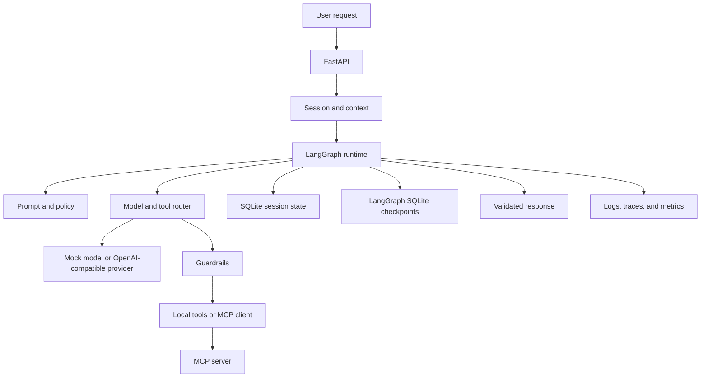

# Architecture

The harness is one LangGraph workflow plus the services that workflow calls.
There is no second planner or agent loop.

## Request path

1. The API or a Python caller creates a session.
2. The runtime loads that session's trimmed history and long-term memories.
3. The prompt layer selects a versioned template. User text is not copied into it.
4. LangGraph runs `prepare -> route -> guard -> execute -> observe -> route`,
   then `finalize` or `fail`.
5. The router asks the configured model for either a final answer or one tool call.
6. Guardrails allowlist the tool, validate arguments, and interrupt for approval
   when the tool is privileged.
7. The runtime executes the tool with a timeout. Idempotent tools may retry
   transient failures a bounded number of times.
8. Tool output is wrapped as untrusted text and sent back to the model.
9. The final answer is validated, the session history is updated, and the task
   status is stored.

## State boundaries

| State | Where it lives | Lifetime |
| --- | --- | --- |
| Conversation history | `messages` table | Until the session is deleted |
| Explicit memories | `memories` table | Until deleted or the session is deleted |
| Task status | `tasks` table | Until the session is deleted |
| Workflow checkpoints | LangGraph SQLite saver | Until `delete_session` removes the thread |

Short-term execution state is the LangGraph checkpoint for one task.
Long-term memory is an explicit row written by `store_memory`.

## Components

| Component | Module |
| --- | --- |
| Session and context | `memory/store.py`, `memory/context.py` |
| Task orchestration | `orchestration/graph.py` |
| Prompt and policy | `prompts/templates.py`, `prompts/policy.py` |
| Model and tool router | `routing/` |
| Memory and state | `memory/store.py` and the LangGraph checkpointer |
| Safety | `safety/` and the graph `guard` node |
| Runtime | `runtime/service.py` |
| Observability | `observability/` |

## MCP boundary

`mcp/server.py` is a standalone stdio server. It can also be connected in
process. It does not open the harness database. `mcp/client.py` discovers
tools and registers only names present in the allowlist. `unapproved_echo` is
intentionally advertised by the server and ignored by the default client.
